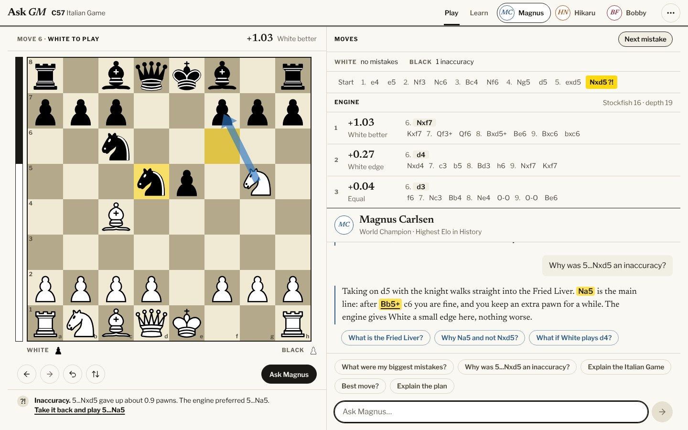
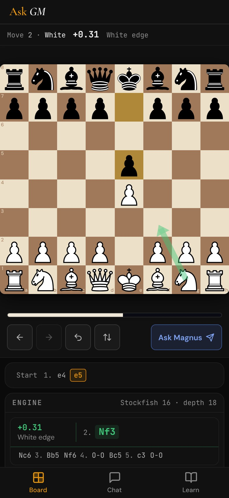
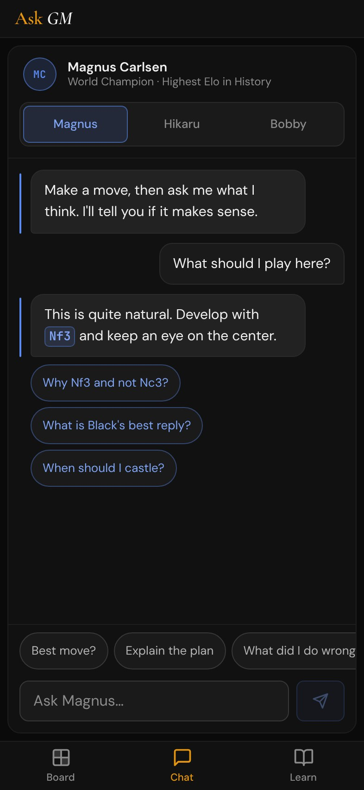

# Ask GM

Chess coaching with AI grandmasters. Play a game on the board, watch Stockfish analyse it live in your browser, and ask **Magnus Carlsen**, **Hikaru Nakamura** or **Bobby Fischer** what they would play, in their own voice, grounded in the engine's actual lines and in facts computed from the position.



<p>
  
  
</p>

*(Screenshots show the interface with a sample conversation.)*

## Features

- **Live engine analysis, in the browser.** Stockfish 16 runs in a Web Worker: top three lines, an eval bar, a best-move arrow, and a preview mode to step through any engine line on the board.
- **Every move is judged.** Best, good, inaccuracy, mistake or blunder, by how much win chance the move gave up (the same idea Lichess uses), shown in the move list and under the board, with *"Take it back and play …"*. A second, quiet engine looks at the positions before your moves, so even a fast game is judged.
- **Review a whole game.** Load a PGN (or paste a FEN) from the game menu: every move is checked, the result is summed up per side, and **Next mistake** jumps between the moves worth a second look. The coach is told what the engine found.
- **Three grandmasters, three voices.** Each has their own persona, their own conversation thread, and a funny in-character brush-off for anything that isn't chess.
- **Answers grounded in the position.** The model is given the FEN, move history, material, king safety, loose pieces and threats (worked out by static exchange, not guessed), pawn structure, the engine lines and the engine's verdict on your moves, and is told to recommend only moves from those lines. Replies are checked for impossible moves and corrected once if needed.
- **Click a suggested move to play it.** Moves in a reply are highlighted like a highlighter pen; the ones that are legal in the position the reply was written for are buttons.
- **A proper end of game.** Checkmate, stalemate and draws get a result card and a scoresheet result (1–0, 0–1, ½–½).
- **Opening lessons.** 27 openings with variations, per-move coaching notes and auto-play, every line checked against Stockfish. The current opening is also detected as you play.
- **Built for phones and laptops.** A two-column layout on laptops; on a phone the board runs edge to edge and a bottom bar switches between Board, Chat and Learn. Respects iPhone safe areas, 16px inputs (no iOS zoom) and reduced motion.
- **Private beta access code**, verified by the server.

The look is a newspaper games page: paper, ink, a news serif and a Franklin sans, thin rules, and colour only where it means something. See [docs/design-system.md](docs/design-system.md).

## Quick start

Requires **Node.js 20.19+** and an [Anthropic API key](https://console.anthropic.com/).

```bash
npm install
cp .env.example .env        # then set ANTHROPIC_API_KEY
npm run dev                 # app on http://localhost:5173, API on :3001
```

Without `BETA_PASSCODE` the access-code gate is off, which is what you want locally.

## Configuration

Set these in `.env` locally, or as service variables on your host. Never commit a real `.env`.

| Variable | Required | Description |
| --- | --- | --- |
| `ANTHROPIC_API_KEY` | yes | Server-side key used for `/api/chat`. Without it chat answers `503`. |
| `BETA_PASSCODE` | no | Access code for the private beta. **If unset, the gate is disabled and the API is open to anyone with the URL** (the server logs a warning in production). Surrounding whitespace/quotes are ignored. |
| `PORT` | no | Defaults to `3001`. Most hosts set this for you. |
| `ANTHROPIC_MODEL` | no | Defaults to `claude-sonnet-5-5`. |
| `TRUST_PROXY` | no | Reverse proxies in front of the app, for correct per-client rate limiting. Defaults to `1` in production (Railway, Heroku, Render…) and off in development. |

## Scripts

| Command | What it does |
| --- | --- |
| `npm run dev` | Vite dev server + Express API together |
| `npm run build` | Type-check, then production build into `dist/` |
| `npm start` | Serve the API **and** the built app on one port (`NODE_ENV=production`) |
| `npm test` | Unit and integration tests (Vitest) |
| `npm run e2e` | End-to-end tests (Playwright): the real app in a real browser, on a laptop and an iPhone-sized screen |
| `npm run lint` | ESLint for the frontend, the server, the tests and the scripts |
| `npm run typecheck` | `tsc -b` |
| `npm run check` | lint + typecheck + tests — run before committing |
| `npm run verify:openings` | Runs Stockfish over every opening lesson and fails on a line that teaches a blunder |
| `npm run verify:tactics` | Checks the "what can be won" facts given to the coach against a brute-force search on thousands of random positions |

The first `npm run e2e` needs a browser: `npx playwright install chromium`. GitHub Actions runs `check`, `build` and `e2e` on every push and pull request (`.github/workflows/`), and the Stockfish lesson check whenever `src/data/openings.ts` changes.

## How it works

```
 Browser                                              Server (Express)                    Anthropic
┌──────────────────────────────┐                     ┌───────────────────────────┐        ┌────────┐
│ React UI                     │  POST /api/chat     │ beta gate → rate limit    │        │ Claude │
│  game · lesson · chat state  │ ──────────────────► │ sanitise + validate input │ ─────► │        │
│                              │  question, FEN,     │ off-topic guard           │        │        │
│ Stockfish 16 (Web Worker)    │  moves, engine      │ computed position facts   │ ◄───── │        │
│  top-3 lines, White-POV eval │  lines, verdicts    │ build prompt (persona +   │        └────────┘
│ Stockfish #2 (quiet worker)  │                     │  facts + lines + review)  │
│  judges moves & whole games  │ ◄────────────────── │ check moves, retry once   │
└──────────────────────────────┘  reply + follow-ups │ strip markdown & emoji    │
                                                     └───────────────────────────┘
```

- **The engine runs client-side**, so analysis is free and instant. The single-threaded Stockfish build is used because it needs no special headers or 40 MB network file (≈ 600 KB total, copied from the `stockfish` package into `/engine/` by a small Vite plugin). Scores are normalised to White's point of view. If a Worker can't start, it falls back to the Lichess cloud-eval cache.
- **Moves are judged from two evaluations**: the position before the move and the one after, both searched to depth 12 or more. The main engine only ever looks at the position on screen, so a second worker searches the others and everything goes into one shared evaluation book. A move is never judged from a shallower search.
- **The server never trusts the browser's opinion.** A verdict arrives as a fixed word, a bounded number and a UCI move; the server replays the move list itself, checks it leads to the position, and writes the sentence for the prompt.
- **Every request field is validated on the server** before it reaches the prompt: the FEN must be a legal position, the opening name is reduced to a plain line, moves must look like SAN/UCI, history roles are whitelisted and reshaped so the Anthropic API accepts them, and sizes are capped. Control and invisible characters are stripped.
- **Facts are computed, not guessed.** Loose pieces and what can be won by capture come from a static exchange evaluation (x-rays, pins and king captures included), alongside pawn structure, the bishop pair, checks and captures, the game phase and how safe each king is *for that phase*.
- **Blatant off-topic requests** (code, "ignore your instructions") get an in-character reply without spending a model call; subtler ones are handled by the persona prompts.
- **Move checking** compares moves named in a reply with the legal moves in the position, the moves along the engine lines, the moves already played and the alternatives at the last few positions. Only a move playable nowhere triggers one corrective retry.

## Beta access code

The beta gate is enforced by the server, not just the UI:

1. On load the browser asks `GET /api/auth/status` whether a code is needed. If not, no prompt is shown.
2. The prompt verifies the code with `POST /api/auth/verify` (constant-time comparison, failed attempts rate-limited). A wrong code is rejected and **not** stored.
3. A stored code is re-verified on load, and any `401` from `/api/chat` (code rotated or revoked) puts the prompt back up and keeps the question so you can retry.

To rotate the code, change `BETA_PASSCODE` and redeploy.

## Deploying (Railway)

- **Build command:** `npm run build`
- **Start command:** `npm start`
- **Variables:** `ANTHROPIC_API_KEY`, `BETA_PASSCODE` (see above). `PORT` is provided by the platform.
- **Health check:** `GET /api/health` (public, returns `{"status":"ok"}`).

The server serves `dist/` itself, caches fingerprinted assets (including the fonts and the engine) for a year, gzips responses, and answers SPA routes with `index.html` (a missing `/assets/*.js` is a real 404, not HTML).

## Project layout

```
server/
  index.js, app.js, config.js     entrypoint · Express app factory · environment config
  gmPersonalities.js              the three persona prompts
  lib/                            betaAuth, sanitize, prompt, coach (pipeline), moveValidation, moveReview,
                                  tactics, chessContext, followUps, plainText, offTopic, classify
  __tests__/                      unit + HTTP integration tests (fake Anthropic client)
src/
  App.tsx                         composition and layout
  components/                     the interface (board, engine, chat, lessons, dialogs, nav…)
  hooks/                          game, lesson, engine, chat, access gate, and the move-judging trio
  engine/                         UCI parsing, the analyzer state machine, the review queue
  lib/                            pure logic: game state, PGN/FEN import, move review, evaluation, material, openings
  styles/                         the design system: tokens, base, primitives, features, motion (+ its tests)
  data/                           opening lessons (engine-verified), grandmaster profiles, piece artwork
e2e/                              Playwright tests and a stand-in for the Anthropic API
scripts/                          verify-openings (Stockfish), make-icons
docs/                             design-system.md, screenshots
```

## Testing

`npm test` runs 400+ tests: the server pipeline over real HTTP with a fake model client (beta gate, validation, error mapping, rate limits, static serving, computed tactics, move review), the engine analyzer against a scripted fake engine (including the stale-`bestmove` race), the review queue, the move-text/tokenizer logic, PGN/FEN import, an **opening-data integrity test** that replays every lesson line with chess.js, and **design-system guards** that fail when a component uses an off-scale font size, a colour that is not a token, a shadow or an emoji.

`npm run e2e` drives the built app in Chromium on a laptop and an iPhone-sized screen, with the real Stockfish and a stand-in for the Anthropic API: playing and promoting, judging a blunder, reviewing a loaded game, the access-code gate (including a rotated code), lessons, layouts from 375px to 1920px, and an accessibility scan (axe) of every screen.

## Security notes

Implemented: server-verified access code, constant-time comparison, rate limiting (chat, and failed code attempts), strict input validation and sanitisation of everything that reaches the prompt, prompt-injection resistance, JSON error handling, `trust proxy` for correct client IPs. Deliberately deferred and tracked: [CORS restriction (#17)](https://github.com/mattkennedy24/Ask-GM/issues/17) and [security headers / CSP (#18)](https://github.com/mattkennedy24/Ask-GM/issues/18).

## Third-party software

- [Stockfish.js](https://github.com/nmrugg/stockfish.js) 16 (WebAssembly build of [Stockfish](https://stockfishchess.org/)) — **GPL-3.0**. It is served to users with the app.
- Chess pieces: the "cburnett" set by Colin M. L. Burnett (CC BY-SA 3.0), as shipped by [react-chessboard](https://github.com/Clariity/react-chessboard).
- Fonts: [Newsreader](https://github.com/productiontype/Newsreader) and [Libre Franklin](https://github.com/impallari/Libre-Franklin) (OFL-1.1), self-hosted through Fontsource.
- [chess.js](https://github.com/jhlywa/chess.js), React, Vite, Tailwind CSS, Playwright, Express, and the [Anthropic SDK](https://github.com/anthropics/anthropic-sdk-typescript).
- Grandmaster personas are stylised portrayals for coaching and entertainment; they are not the people, and nothing here is endorsed by them.
